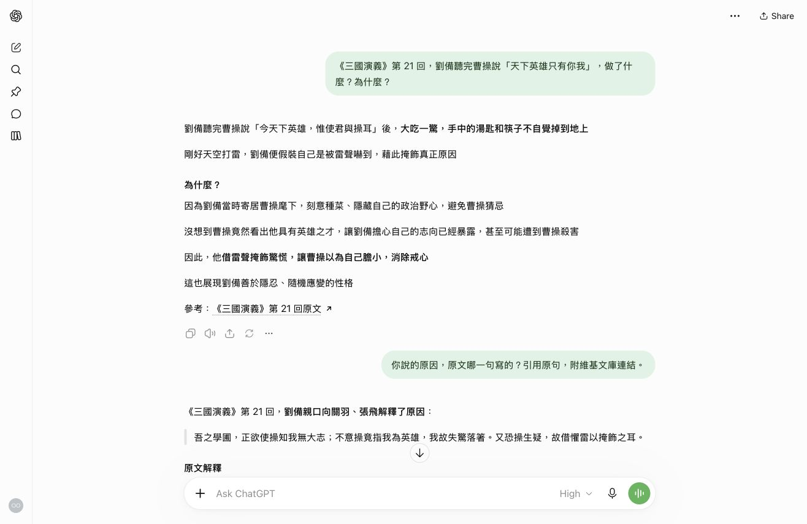
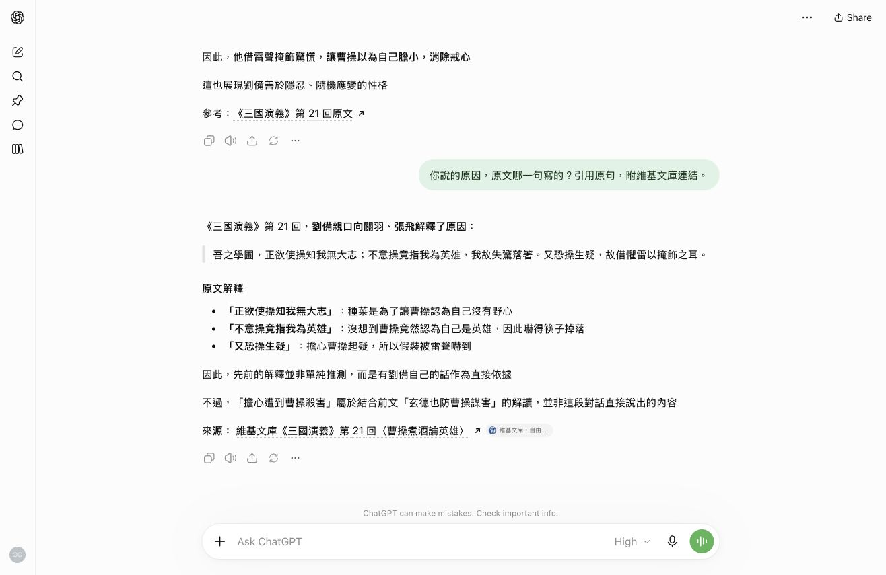
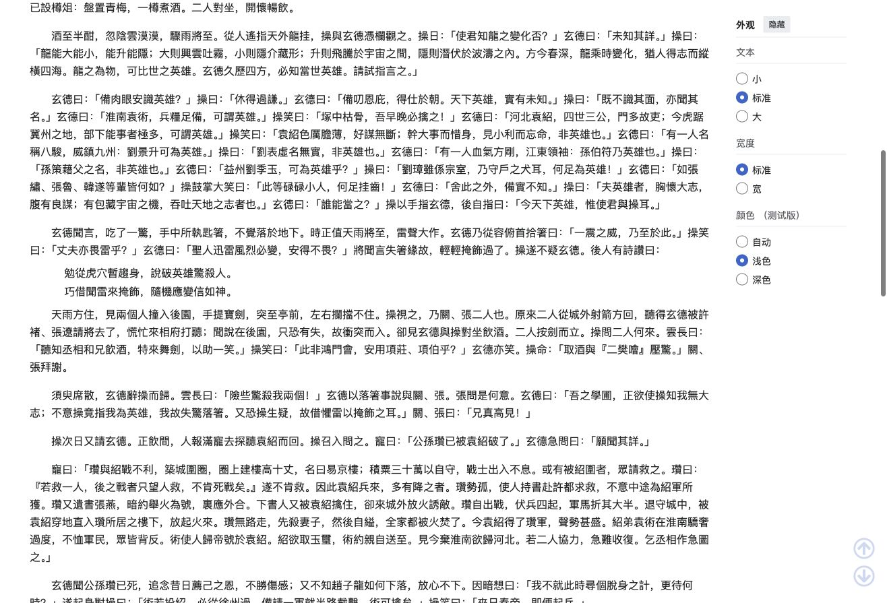
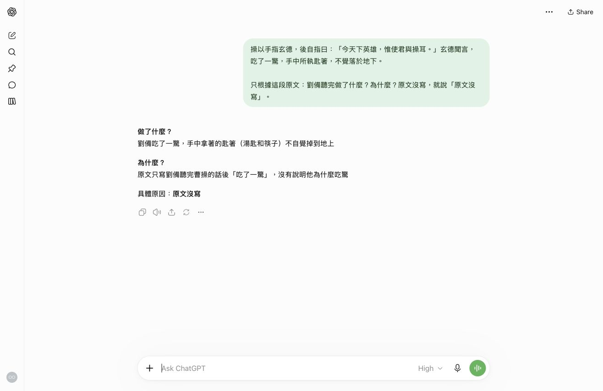
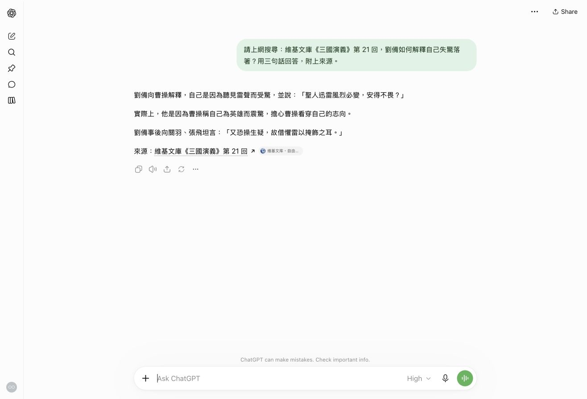

# 練習 1 參考結果

> 先自己做完練習 1，再來看這頁。
> 你的 AI 回答字句一定不一樣，沒關係。每題只要對照「重點」就好。

## 這個練習在教什麼

**同一個問題，給不給 AI 資料，答案會不一樣。**

| 步驟 | 像什麼 | 你在做什麼 |
| --- | --- | --- |
| 1-1 | 閉書考 | 不給資料，看 AI 憑記憶怎麼答 |
| 1-2 | 對答案 | 叫它說出原文哪一句，你自己去原文找 |
| 1-3 | 開書考 | 只給一小段原文，看它會不會多講 |

---

## 1-1 先不給資料問一次

你貼的：

```text
《三國演義》第 21 回，劉備聽完曹操說「天下英雄只有你我」，做了什麼？為什麼？
```



**重點**

- 做了什麼：吃了一驚，筷子掉到地上。
- 為什麼：怕曹操看穿他的野心，就假裝是被雷聲嚇到。
- 它自己附了一個維基文庫連結。**有連結不代表答對**，你還沒點開來看。

---

## 1-2 追問：原因寫在原文哪一句

你貼的：

```text
你說的原因，原文哪一句寫的？引用原句，附維基文庫連結。
```



它引用的句子：

> 吾之學圃，正欲使操知我無大志；不意操竟指我為英雄，我故失驚落箸。又恐操生疑，故借懼雷以掩飾之耳。

**自己查**

1. 打開 [維基文庫第 21 回](https://zh.wikisource.org/wiki/三國演義/第021回)。
2. 按 `Cmd+F`（Mac）或 `Ctrl+F`（Windows），搜尋「掩飾」。
3. 會跳出好幾個。找劉備回家後對關羽、張飛說的那段（開頭是「須臾席散」）。



**重點**

- 原文找得到同一句，所以 1-1 說的原因是有出處的。
- 它還主動說：「怕被曹操殺害」是它從前文推出來的，不是這句寫的。好的回答會分清楚哪些是原文寫的、哪些是它自己推的。

---

## 1-3 開新對話，只給一段原文

你貼的：

```text
操以手指玄德，後自指曰：「今天下英雄，惟使君與操耳。」玄德聞言，吃了一驚，手中所執匙箸，不覺落於地下。

只根據這段原文：劉備聽完做了什麼？為什麼？原文沒寫，就說「原文沒寫」。
```



**重點**

- 做了什麼：和 1-1 一樣，筷子掉到地上。
- 為什麼：**原文沒寫**。

為什麼這次答不出原因？因為你給的那段只寫到「吃了一驚」。劉備說明原因的那句在後面，你沒給它。它照你給的資料回答，這就是我們要的結果。

---

## 1-1 和 1-3 放在一起比

| | 1-1 閉書考 | 1-3 開書考 |
| --- | --- | --- |
| 做了什麼 | 筷子掉到地上 | 筷子掉到地上 |
| 為什麼 | 怕野心被看穿 | 原文沒寫 |
| 根據什麼 | 它的記憶，或它自己上網找的 | 只有你給的那段 |

**帶走一句話：** 你給 AI 什麼資料，它就照什麼回答。想知道它說的對不對，就叫它指出原文哪一句，再自己去查。

---

## 你的結果不一樣？

| 你看到的 | 代表什麼 | 下一步 |
| --- | --- | --- |
| 1-1 沒有附連結 | 正常，有時附、有時不附 | 照樣做 1-2 |
| 1-2 引的句子在原文找不到 | 它引錯了，這就是練習要抓的 | 貼「這句我在原文找不到，請重新引用原句」 |
| 1-3 它又說「怕被看穿」 | 它加了原文沒寫的東西 | 貼「原文哪一句寫了這個原因？」 |

---

## 小練習：上網搜尋

老師挑的題目（你的題目會不一樣）：

```text
請上網搜尋：維基文庫《三國演義》第 21 回，劉備如何解釋自己失驚落箸？用三句話回答，附上來源。
```



**重點**

- 三句話、有附來源：照要求做了。
- 但畫面上沒看到「已思考」，也沒看到搜尋過程。光看到一個連結，沒辦法確定它真的上網查了。
- 所以還是要**點開來源，自己對一次**。

---

## 其他

- 截圖字太小、想複製句子：看 [對話文字.md](對話文字.md)。
- 練習 2（Codex 寫大綱）的參考成果：[三國演義大綱.md](https://github.com/Chrouos/AI-workshop-slides/blob/main/examples/aw-01-sample-output/三國演義大綱.md)。
- 這頁是老師在 2026-10-26 用 ChatGPT 網頁版（Plus，思考強度 High）實際跑的結果。每題只送一次，沒有重跑挑答案。
