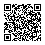
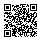
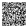
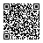
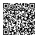
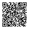
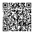
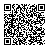
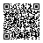
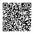

# QR code 總表

投影或印出來給學生掃。每張都已解碼核對過，掃了會直接打開下面寫的網址；標「ZIP」的會直接下載。

簡報投影片上已經有每堂的提示詞 QR（第一、二堂另有該堂的 ZIP），這裡是全部集中的版本，含簡報上沒有的第三、四堂 ZIP。每堂只有一個 ZIP。

## 先掃這兩張

| 教材總表（四堂的下載都在這） | 簡報首頁 |
| :---: | :---: |
|  |  |
| github.com/Chrouos/AI-workshop-slides/tree/main/examples | chrouos.github.io/AI-workshop-slides |

## 每一堂

| 堂 | 提示詞 | 下載 |
| --- | :---: | :---: |
| 第一堂：認識 AI，學會用 Codex |  aw-01-lab/prompts.md |  ZIP：aw-01-lab.zip（練習資料夾） |
| 第二堂：Obsidian 與 AI Agent |  aw-02-lab/prompts.md |  ZIP：aw-02-lab.zip（筆記庫＋參考結果） |
| 第三堂：Skills |  aw-03-lab/prompts.md |  ZIP：aw-03-lab.zip（備用 Skill＋參考結果） |
| 第四堂：發布到網站 |  aw-04-lab/prompts.md（含課前作業） |  ZIP：aw-04-lab.zip（第三堂完成版＋參考結果） |

## 檔案對照

| 檔案 | 網址 |
| --- | --- |
| materials.svg | https://github.com/Chrouos/AI-workshop-slides/tree/main/examples |
| slides.svg | https://chrouos.github.io/AI-workshop-slides/ |
| aw-01-prompts.svg | https://github.com/Chrouos/AI-workshop-slides/blob/main/examples/aw-01-lab/prompts.md |
| aw-01-lab-zip.svg | https://raw.githubusercontent.com/Chrouos/AI-workshop-slides/main/examples/aw-01-lab.zip |
| aw-02-prompts.svg | https://github.com/Chrouos/AI-workshop-slides/blob/main/examples/aw-02-lab/prompts.md |
| aw-02-lab-zip.svg | https://raw.githubusercontent.com/Chrouos/AI-workshop-slides/main/examples/aw-02-lab.zip |
| aw-03-prompts.svg | https://github.com/Chrouos/AI-workshop-slides/blob/main/examples/aw-03-lab/prompts.md |
| aw-03-lab-zip.svg | https://raw.githubusercontent.com/Chrouos/AI-workshop-slides/main/examples/aw-03-lab.zip |
| aw-04-prompts.svg | https://github.com/Chrouos/AI-workshop-slides/blob/main/examples/aw-04-lab/prompts.md |
| aw-04-lab-zip.svg | https://raw.githubusercontent.com/Chrouos/AI-workshop-slides/main/examples/aw-04-lab.zip |

QR 裡的中文路徑是編碼過的網址（`%E4%B8%89…`），掃出來長得不一樣是正常的。路徑或檔名改了，這些 QR 就要重做。
